# Diagrama entidad-relación — BikePOS

> Fase 1. **✅ Aprobado.** Tras tu aprobación se agregaron campos menores que salen directo de tus decisiones posteriores (no cambian la estructura general, solo la documentan y agregan columnas de datos). Están marcados abajo. Formato [Mermaid](https://mermaid.js.org/); **GitHub lo renderiza automáticamente**. Si tu editor local no lo renderiza, la tabla de atributos de la sección 2 tiene la misma información en texto plano.

## 1. Diagrama

```mermaid
erDiagram
    USERS ||--o{ SALES : "vende (seller_id)"
    USERS ||--o{ INVENTORY_MOVEMENTS : "realiza"
    USERS ||--o{ AUDIT_LOG : "genera"
    USERS ||--o{ CASH_SESSIONS : "abre/cierra"
    USERS ||--o{ PAYMENTS : "cobra"

    CATEGORIES ||--o{ PRODUCTS : "clasifica"
    BRANDS ||--o{ PRODUCTS : "clasifica"

    PRODUCTS ||--o{ INVENTORY_MOVEMENTS : "tiene"
    PRODUCTS ||--o{ SALE_ITEMS : "se vende como"

    SALES ||--|{ SALE_ITEMS : "contiene"
    SALES ||--o{ PAYMENTS : "recibe"
    SALES ||--o{ RETURNS : "puede tener"

    SALE_ITEMS ||--o| PRICE_OVERRIDE_REQUESTS : "puede requerir"
    SALE_ITEMS ||--o{ RETURN_ITEMS : "se devuelve en"

    RETURNS ||--|{ RETURN_ITEMS : "detalla"
    RETURNS ||--o{ REFUNDS : "genera"

    CASH_SESSIONS ||--o{ PAYMENTS : "agrupa"
    CASH_SESSIONS ||--o{ CASH_EXPENSES : "registra"
    CASH_SESSIONS ||--o{ REFUNDS : "agrupa"

    PRICE_OVERRIDE_REQUESTS ||--o| EMERGENCY_CODES : "o se resuelve con"

    SYNC_OPERATIONS ||--o| SALES : "origina (si aplica)"

    USERS {
        int id PK
        string username
        string display_name
        string role "VENDEDOR | ADMIN | SUPER_ADMIN"
        boolean active
        int role_sequence_number
        boolean must_change_password
        string password_hash
        datetime created_at
        datetime updated_at
    }

    CATEGORIES {
        int id PK
        string name
        boolean active
    }

    BRANDS {
        int id PK
        string name
        boolean active
    }

    PRODUCTS {
        string id PK "PROD-XXXX-0000"
        string name
        int category_id FK "nullable"
        int brand_id FK "nullable"
        decimal purchase_price
        decimal retail_price
        decimal wholesale_price
        decimal profit_percentage
        int stock
        int min_stock "nullable"
        boolean active
        datetime created_at
        datetime updated_at
    }

    ID_COUNTERS {
        string prefix PK
        int last_number
    }

    INVENTORY_MOVEMENTS {
        bigint id PK
        string product_id FK
        string type "ALTA|BAJA|VENTA|DEVOLUCION|CANCELACION|APARTADO|AJUSTE"
        int quantity
        int previous_stock
        int resulting_stock
        int user_id FK
        string reason "obligatorio si es BAJA"
        datetime created_at
        bigint related_sale_id FK "nullable"
    }

    SALES {
        bigint id PK
        string folio "DD-MM-AAAA-NN"
        date sale_date
        int seller_id FK
        string status "PAGADO|EN_PROCESO_DE_PAGO|CANCELADO"
        datetime finalized_at "nullable, apartados"
        string customer_name "nullable, solo apartados"
        string customer_phone "nullable, solo apartados"
        boolean created_offline
        string client_operation_id "uuid, idempotencia"
        datetime created_at
    }

    SALE_ITEMS {
        bigint id PK
        bigint sale_id FK
        string item_type "PRODUCTO|SERVICIO"
        string price_type "MENUDEO|MAYOREO|PERSONALIZADO"
        decimal unit_price
        int quantity
        string description
        string product_id FK "nullable si es servicio"
        boolean pending_review
    }

    PAYMENTS {
        bigint id PK
        bigint sale_id FK
        string method "EFECTIVO|TRANSFERENCIA|TARJETA"
        decimal amount
        datetime paid_at
        int user_id FK
        bigint cash_session_id FK
    }

    RETURNS {
        bigint id PK
        bigint sale_id FK
        int user_id FK
        string reason
        datetime created_at
    }

    RETURN_ITEMS {
        bigint id PK
        bigint return_id FK
        bigint sale_item_id FK
        int quantity
    }

    REFUNDS {
        bigint id PK
        bigint return_id FK "nullable"
        boolean is_cancellation
        string method "siempre EFECTIVO — regla D5"
        decimal amount
        int user_id FK
        bigint cash_session_id FK
        datetime created_at
    }

    CASH_SESSIONS {
        bigint id PK
        date session_date
        datetime opened_at
        int opened_by FK
        datetime closed_at "nullable"
        int closed_by FK "nullable"
        decimal initial_fund
        decimal counted_cash "nullable — CE, efectivo contado a mano"
        decimal counted_card_transfer "nullable — CTT, agregado: tarjeta+transferencia contado a mano, un solo campo"
        decimal expected_cash "nullable, congelado al cerrar"
        decimal expected_total "nullable, congelado al cerrar — agregado: Total con fondo"
        decimal cash_difference "nullable — Diferencia Efectivo (antes 'difference')"
        decimal total_difference "nullable — agregado: Diferencia Total"
    }

    CASH_EXPENSES {
        bigint id PK
        bigint cash_session_id FK
        string concept
        decimal amount
    }

    PRICE_OVERRIDE_REQUESTS {
        bigint id PK
        bigint sale_item_id FK
        decimal requested_price
        string reason
        string code_hash
        datetime expires_at
        int attempts
        string status "PENDIENTE|AUTORIZADO|RECHAZADO|VIA_C|VIA_D"
        int seller_id FK
        int approved_by FK "nullable"
    }

    EMERGENCY_CODES {
        bigint id PK
        string batch_id
        string code_hash
        int used_by FK "nullable"
        datetime used_at "nullable"
        bigint sale_item_id FK "nullable"
        decimal price_used "nullable"
    }

    AUDIT_LOG {
        bigint id PK
        string event_type
        int user_id FK
        datetime occurred_at
        bigint sale_id FK "nullable"
        string reason "nullable"
        json details
    }

    REVIEW_QUEUE {
        bigint id PK
        string type "STOCK_NEGATIVO|PRECIO_VIA_C|CONFLICTO_SYNC"
        bigint reference_id
        string status "PENDIENTE|RESUELTO"
        int resolved_by FK "nullable"
        datetime resolved_at "nullable"
        string note "nullable"
        datetime notified_at "nullable — agregado: correo enviado al admin"
    }

    SYNC_OPERATIONS {
        string id PK "uuid generado en el cliente"
        string operation_type
        string status "PENDIENTE|APLICADA|RECHAZADA"
        datetime applied_at "nullable"
        json payload
    }

    FOLIO_COUNTERS {
        date folio_date PK
        int last_number
    }

    STORE_SETTINGS {
        int id PK
        string name
        string address
        string phone
        string authorization_email
        string authorization_sms "nullable"
    }

    TICKET_TEMPLATE {
        int id PK
        json layout
    }

    BACKUP_LOG {
        bigint id PK
        datetime generated_at
        int generated_by FK
    }
```

## 2. Notas de diseño

- **Instantánea de precios:** `sale_items.unit_price` guarda el precio aplicado en el momento de la venta; cambiar `products.retail_price` después no altera tickets pasados. Por eso `sale_items` no depende de `products` para mostrar el precio histórico.
- **Bajas lógicas:** `users`, `categories`, `brands` y `products` usan `active` en vez de borrado físico.
- **`refunds`** se modela con `return_id` opcional + `is_cancellation`: un reembolso siempre está ligado a una devolución explícita **o** es el reembolso automático que genera una cancelación. Esto evita una tabla `cancellations` separada, ya que una cancelación es, en efectos de datos, "todo se devuelve + se reembolsa todo".
- **`refunds.method`:** por regla de negocio (D5), este campo siempre vale `EFECTIVO` — el vendedor no tiene acceso a la cuenta bancaria ni a la terminal de la tienda para devolver dinero por transferencia o tarjeta. Se deja como enum abierto en la base de datos por si la política cambia en el futuro, pero la aplicación lo fuerza a `EFECTIVO` en el backend.
- **`cash_sessions` — dos diferencias (agregado):** al cerrar, se capturan `counted_cash` (CE) y `counted_card_transfer` (CTT) **en el mismo paso**. El backend congela `expected_cash` (Efectivo esperado) y `expected_total` (Total con fondo) en ese momento, y calcula `cash_difference` = CE − `expected_cash`, y `total_difference` = (CE + CTT) − `expected_total`. Ver `docs/reglas-corte-apartados-devoluciones.md` sección 1 para el detalle de qué detecta cada una.
- **`review_queue.notified_at`:** cuando una venta sincronizada deja stock negativo, además de quedar en la cola de revisión, el sistema envía un correo al contacto de autorizaciones. Este campo guarda cuándo se envió ese correo.
- **`sync_operations`** usa como PK el id generado en el cliente (UUID), no un autoincremental del servidor — es la pieza central de la idempotencia (ADR-004 en `docs/decisions.md`).
- **`review_queue`** es genérica (`type` + `reference_id`) para no crear una tabla distinta por cada tipo de conflicto (stock negativo, precio vía C, conflicto de sincronización).
- Todas las tablas con fecha/hora se guardan en UTC y se presentan en `America/Mexico_City` (zona horaria de la tienda).
- `audit_log` no tiene `updated_at` ni soporta `UPDATE`/`DELETE` a nivel de base de datos (ver `plan.md`, sección 6, "Principios").
- Índices previstos: `products(name)` y `products(id)` con `pg_trgm`/`unaccent` para búsqueda; `sales(folio)` único por fecha; `sales(sale_date)`; `inventory_movements(product_id, created_at)`; `audit_log(occurred_at)`, `audit_log(user_id)`.

## 3. Pendiente de esta fase

Este modelo es preliminar (coincide con `plan.md` sección 6) y se ajustará con detalle de tipos exactos y constraints en la Fase 3–4, cuando se escriban las migraciones (Flyway). Cualquier cambio de estructura a partir de ahí se documenta como una entrada nueva en `docs/decisions.md`.
