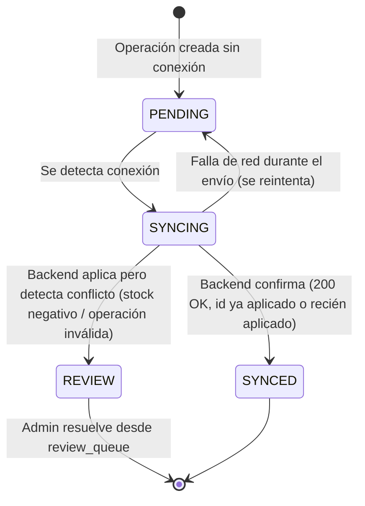

# Diseño del modo sin conexión — BikePOS

> Fase 1. **✅ Aprobado.** Incluye el detalle que agregaste sobre el aviso al admin cuando una venta sincronizada deja stock negativo (sección 4, punto 3, y sección 8).

---

## 1. Alcance

Solo la **PC del mostrador** opera en modo local-first. Cualquier otro dispositivo (admin en su celular, tablet, otra PC) siempre requiere conexión — no replica nada localmente.

---

## 2. Qué vive en la copia local (IndexedDB vía Dexie.js)

| Store (tabla local) | Contenido | Notas de seguridad |
|---|---|---|
| `catalogCache` | Productos: ID, nombre, categoría, marca, **precio de menudeo, precio de mayoreo, stock**, stock mínimo | **Nunca** incluye precio de compra ni % de ganancia (ADR de seguridad, ver `plan.md` sección 10) |
| `usersCache` | Usuarios que ya iniciaron sesión antes en esa PC: username, rol, **verificador derivado** (no la contraseña ni su hash reversible) | Permite validar el login sin conexión sin exponer la contraseña real |
| `salesCache` | Tickets de los **últimos 30 días** (folio, partidas, pagos, estado) | Para reimpresión y para cancelar/devolver sin conexión |
| `layawaysCache` | **Todos** los apartados pendientes, sin límite de antigüedad | A diferencia de `salesCache`; un apartado puede tardar semanas en liquidarse |
| `syncQueue` | Operaciones creadas sin conexión, pendientes de enviar al backend | Ver sección 3 |
| `folioCounter` | Consecutivo local del folio del día en curso | Ver sección 5 |
| `appMeta` | `lastSyncAt`, `lastCatalogRefreshAt`, contador de operaciones pendientes | Para el aviso "N ventas sin sincronizar" |

---

## 3. Cola de sincronización (`syncQueue`)

Cada operación creada sin conexión (venta, abono a apartado, cancelación, devolución, ajuste de caja) se guarda como un registro:

```json
{
  "clientOperationId": "uuid-v4",
  "type": "CREATE_SALE | CREATE_LAYAWAY_PAYMENT | CANCEL_SALE | CREATE_RETURN | CLOSE_CASH_SESSION | ...",
  "payload": { "...": "datos completos de la operación" },
  "createdAt": "2026-09-24T14:32:00-06:00",
  "status": "PENDING | SYNCING | SYNCED | ERROR"
}
```

Reglas:
- El `clientOperationId` se genera **una sola vez**, al crear la operación localmente, y viaja con ella hasta el servidor (ADR-004, `docs/decisions.md`).
- Las operaciones se guardan y se muestran en la UI (ticket impreso, apartado creado, etc.) **antes** de intentar sincronizar — la venta nunca espera a la red.
- El estado `ERROR` no descarta la operación: queda visible para reintento manual o para revisión del admin.

---

## 4. Proceso de sincronización



**Pasos, en orden:**

1. La PC detecta conexión (evento `online` del navegador + verificación real contra el backend, no solo el evento del navegador, que puede ser falso positivo).
2. Envía las operaciones de `syncQueue` en estado `PENDING`, **en el orden en que se crearon** (`createdAt` ascendente), en lotes (`POST /api/sync/operations`).
3. El backend, por cada operación:
   - Si el `clientOperationId` ya existe en `sync_operations` → responde con el resultado ya guardado (idempotencia), no la vuelve a aplicar.
   - Si es nueva → la valida y la aplica dentro de una transacción.
   - **Conflicto de stock negativo** (el admin bajó o retiró el stock manualmente mientras la PC estaba sin conexión, y la copia local no se había enterado del cambio): la venta **se acepta igual** —para la PC, en ese momento, el producto sí tenía stock según su copia local, así que el vendedor no hizo nada mal— y se marca en `review_queue` con tipo `STOCK_NEGATIVO`, con entrada en auditoría. **Además, el sistema envía un correo** al contacto de autorizaciones (el mismo configurado para los códigos de precio personalizado) avisando qué venta se aplicó y qué producto quedó con stock negativo, para que el admin se entere sin depender de revisar el dashboard.
   - **Cualquier otro motivo de invalidez** (ej. la caja del día ya fue cerrada por otro medio, un apartado ya fue cancelado): no se descarta la operación; se registra en `review_queue` con tipo `CONFLICTO_SYNC` para que el admin decida.
4. El backend **recalcula el corte** del día afectado si la sincronización cambia sus totales, y marca cualquier diferencia contra lo ya cerrado (si el corte de ese día ya se había cerrado localmente, la diferencia también queda visible para el admin).
5. La PC marca cada operación como `SYNCED` (o `REVIEW` si el backend la mandó a revisión) y actualiza `appMeta.lastSyncAt`.
6. La PC pide `GET /api/sync/folio-counter` y **reconcilia su contador local de folios** con el valor confirmado por el servidor, para la siguiente venta.
7. La PC pide `GET /api/sync/catalog-snapshot` para refrescar `catalogCache` (precios/stock actualizados, sin precio de compra ni %).

---

## 5. Folio local

- Mientras está sin conexión, la PC asigna folios usando su propio `folioCounter` (consecutivo por día, formato `DD-MM-AAAA-NN`), exactamente igual que si estuviera en línea.
- El folio es **definitivo en cuanto se imprime**, haya o no conexión — nunca se reescribe.
- Como solo existe **una caja y una PC de mostrador**, no hay riesgo de que dos folios colisionen entre sí mientras la tienda opera con normalidad.
- Al reconectar, la PC llama a `GET /api/sync/folio-counter?date=` y **adopta el valor que confirme el servidor** como punto de partida para el siguiente folio, para blindarse ante el caso excepcional de que el servidor ya tuviera un folio del mismo día (por ejemplo, si alguien vendiera manualmente desde otra fuente, lo cual no debería ocurrir en el diseño normal, pero se reconcilia por seguridad).

---

## 6. Qué requiere conexión siempre (recordatorio de `plan.md` sección 5)

| Requiere conexión | Motivo |
|---|---|
| Primer inicio de sesión y cambio de contraseña | No hay verificador local todavía |
| Precio personalizado (código, C y D) | Depende del correo al admin |
| Categorías, marcas, productos, ajustes de stock | Son operaciones de catálogo, siempre en el backend |
| Usuarios y contraseñas | Gestión administrativa |
| Dashboard, auditoría, reportes PDF, respaldo | Requieren datos consolidados del servidor |
| Cancelar/devolver tickets más antiguos que la copia local (30 días) | No están en `salesCache` |
| Configuración de tienda y de ticket | Cambian el comportamiento global del sistema |

---

## 7. Riesgo y mitigación

**Riesgo:** las operaciones en `syncQueue` viven únicamente en el navegador de esa PC. Si se borran los datos del navegador o la PC falla antes de sincronizar, esas ventas se pierden sin registro en el servidor.

**Mitigaciones de esta fase:**
- Aviso permanente y visible en la UI: "N ventas sin sincronizar" mientras `syncQueue` tenga registros en `PENDING` o `ERROR`.
- Botón de **exportar pendientes** (JSON o CSV) para respaldo manual antes de cualquier mantenimiento riesgoso del navegador/PC.
- Sincronizar tan pronto se detecta conexión, sin esperar una acción del usuario.
- (Fuera de esta fase, a evaluar más adelante) considerar `BroadcastChannel`/`Service Worker` con `Background Sync API` si el navegador lo soporta, para reintentar incluso si la pestaña se cierra — se evalúa en la Fase 2 con el navegador real de la tienda (pendiente H2).

---

## 8. Aprobación

Confirmado por ti:
1. ✅ Qué vive en la copia local (sección 2), tal como se propuso.
2. ✅ El mecanismo de idempotencia y el manejo de conflictos al sincronizar (secciones 3–4), incluyendo que el stock negativo se acepta, se marca para revisión, y **además dispara un correo al admin** — detalle que agregaste y que ya quedó incorporado en el paso 3 de la sección 4.
3. ✅ Que el folio se reconcilia contra el servidor al reconectar, sin reescribir un folio ya impreso (sección 5).

**El diseño offline queda aprobado y cerrado.**
